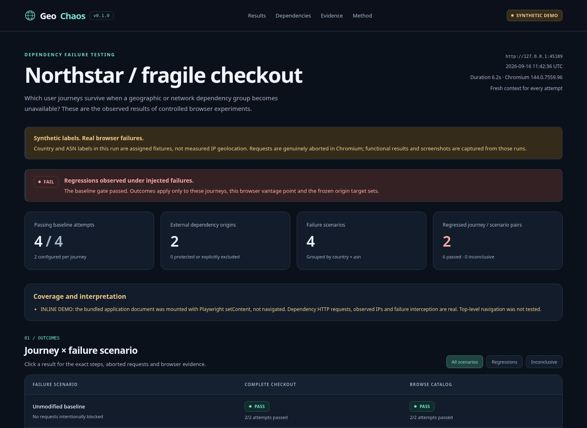

# GeoChaos

**Geographic dependency failure testing for web applications.**

<!-- project-links:start -->
[Source](https://github.com/reza-trendplus/geochaos) | [Demo site](https://reza-trendplus.github.io/geochaos/) | [Publish your copy](PUBLISHING.md) | [AI disclosure](CREDITS.md)
<!-- project-links:end -->

**Your checkout should not depend on your recommendation widget being online.**

GeoChaos is a TypeScript CLI and library that turns observed IP intelligence into controlled browser failure experiments. It records the server IPs contacted by a passing journey, uses **IP2Location.io** to classify external dependencies by reported country and ASN, freezes exact origin target sets, then reruns the same journey while aborting those requests.

The result is a self-contained HTML report: a journey-by-scenario matrix, exact target origins, assertion failures, browser screenshots, and explicit coverage warnings. A machine-readable JSON report accompanies it.



**Vibe coded with ChatGPT Pro 6.** AI-assisted development is disclosed in
[CREDITS.md](CREDITS.md); the publishing maintainer is responsible for reviewing and
verifying the work. This is a local CLI/library, not a hosted testing service.

## For judges and first-time visitors

Start with the report preview above or run the no-key demo below. Both storefronts
pass their baselines; only the fragile checkout fails when its recommendation
service is unavailable. Live mode uses IP2Location country/ASN classifications to
determine the scenarios. Synthetic examples are labeled; unknown coverage is never
silently presented as a passing result.

Publishing this project? [PUBLISHING.md](PUBLISHING.md) contains copy-and-paste GitHub,
Pages, release, and contest-submission instructions. The Pages build publishes only
allowlisted historical synthetic samples, not your real test output.

## Quick start

Requirements: Node.js 22 or newer, npm, and a supported Chromium installation. The first installation needs internet access to obtain dependencies and the browser.

```bash
cd geochaos
npm run setup
npm run browser:install
npm run check
npm run demo
```

`setup` repairs any missing lockfile integrity metadata using the pinned npm
packages, then performs a clean dependency install. Review and commit a changed
lockfile. Subsequent installations can use `npm ci`. On Linux, missing browser
system libraries may require `npx playwright-core install --with-deps chromium`.

Open the `geochaos-reports/demo/index.html` path printed by the command. The demo starts three loopback-only HTTP servers on automatically assigned ports, runs two storefront variants, and closes everything when finished. No API key, public website, payment, or cloud account is involved in the demo.

Expected demo outcomes:

| Test | Fragile checkout | Resilient checkout |
| --- | --- | --- |
| Baseline attempts | 4 passed | 4 passed |
| Journey/scenario pairs | 8 tested | 8 tested |
| Recommendation-country scenario, checkout | Fails | Passes |
| Recommendation-ASN scenario, checkout | Fails | Passes |
| Analytics failures and browsing | Pass | Pass |
| Regressed pairs | 2 | 0 |

Country and ASN labels in the demo are **synthetic**. Actual observed server IPs remain loopback addresses. The browser requests, aborts, assertions, and screenshots are real. `demo` exits 0 only if its expected before-and-after outcomes are observed. An ordinary `run` exits 1 for regressions.

### Restricted browser environments

The bundled demo also supports:

```bash
node dist/cli.js demo --inline
```

This mounts only the bundled storefront HTML with Playwright `setContent` rather than navigating the main document. Dependency requests still go to the real local HTTP servers, and the browser still intercepts and aborts them. Reports prominently disclose that **top-level navigation was not tested**. No browser policy is modified. This mode is only available for the included demo, not arbitrary websites.

To use an already installed compatible browser:

```bash
GEOCHAOS_CHROMIUM_PATH=/usr/bin/chromium node dist/cli.js demo --inline
```

The delivered sample reports were produced in this explicitly disclosed inline mode. See [the verification record](docs/VERIFICATION.md) for the exact build environment and remaining verification boundaries.

## Run against your application

Start a test/staging instance, then create a config:

```bash
node dist/cli.js init
```

Edit `geochaos.config.mjs`, set `baseURL`, list any additional owned origins under `firstPartyOrigins`, and replace the smoke test with meaningful application assertions.

Supply your key as an environment variable, not inside the config or source repository:

```bash
export IP2LOCATION_API_KEY='your-own-key'
node dist/cli.js lookup 8.8.8.8
node dist/cli.js run --config geochaos.config.mjs
```

Alternatively, copy `.env.example` to `.env` and use Node's explicit environment-file support:

```bash
node --env-file=.env dist/cli.js run
```

GeoChaos does not automatically read `.env`. Keyless live lookups require an explicit opt-in:

```bash
node dist/cli.js lookup 8.8.8.8 --keyless
node dist/cli.js run --keyless
```

PowerShell users can set environment variables with `$env:IP2LOCATION_API_KEY = 'your-own-key'` before running the same Node commands.

The live provider uses the fixed HTTPS IP2Location.io endpoint and Bearer authorization. It keeps an in-memory cache of unique IP lookups for the run, skips non-public/special-use addresses, validates the returned IP, limits the number of unique IPs, bounds timeouts, and allows at most one retry per IP. No persistent provider-data cache is shipped.

**Use only authorized staging/test systems and synthetic accounts.** GeoChaos changes only its test browser's traffic, but journey actions still reach your application. A checkout, deletion, notification, or account update in a journey can be real. Make test data resets and idempotency part of the journey design.

## A real journey configuration

```js
import { defineConfig, assert } from 'geochaos';

export default defineConfig({
  name: 'Staging storefront',
  baseURL: 'http://localhost:3000',
  firstPartyOrigins: ['http://localhost:3001'],
  groupBy: ['country', 'asn'],
  baselineRuns: 2,
  scenarioRuns: 2,
  screenshots: 'all',
  screenshotMasks: ['[data-private]', 'input[type="password"]'],
  diagnostics: false,
  geo: { mode: 'live', maxLookups: 200 },
  journeys: [{
    name: 'Complete a test order',
    steps: [
      {
        name: 'Open a product',
        run: async ({ page, baseURL }) => {
          const response = await page.goto(baseURL, {
            waitUntil: 'domcontentloaded',
          });
          assert(response?.ok(), 'Storefront must respond successfully.');
          await page.getByRole('heading', { name: 'Test product' }).waitFor();
        },
      },
      {
        name: 'Add to cart',
        run: async ({ page }) => {
          await page.getByRole('button', { name: 'Add to cart' }).click();
          await page.getByText('1 item in your cart', { exact: true }).waitFor();
        },
      },
      {
        name: 'Finish a synthetic checkout',
        run: async ({ page }) => {
          await page.getByRole('button', { name: 'Complete test order' }).click();
          await page.getByTestId('order-confirmed').waitFor();
        },
      },
    ],
  }],
});
```

Selectors must match your own application. Config files use `.mjs` and execute as trusted Node.js code. Each step receives `page`, `baseURL`, and a cancellation `signal`. The re-exported `assert` is Node's strict assertion module; browser locators provide Playwright's waiting behavior. No custom assertion language is required.

A passing title/body smoke test proves little. Assert meaningful business outcomes, including graceful degradation. Do not modify routing, service-worker handling, or cache behavior inside a journey; this can invalidate the experiment.

### Selecting scenarios

```bash
# Only the country group DE.
node dist/cli.js run --country DE

# Only the selected networks.
node dist/cli.js run --asn 15169,13335

# Both explicitly selected grouping dimensions.
node dist/cli.js run --country DE,NL --asn 15169

# Increase repetition and save to a different parent directory.
node dist/cli.js run --scenario-runs 3 --output ./evidence

# Inspect the browser, or avoid screenshot artifacts.
node dist/cli.js run --headed
node dist/cli.js run --no-screenshots
```

Country or ASN flags select just their corresponding dimensions unless `--group-by` is also provided. Missing requested groups, unknown/partial labels, instrumentation failures, and a truncated scenario plan do not quietly become green results.

`maxScenarios` defaults to 12. It limits execution, not coverage claims: a truncated plan is explicitly incomplete and returns exit 2 unless a regression was also observed, in which case exit 1 takes precedence.

## Results and exit codes

| Exit | Meaning |
| --- | --- |
| `0` | Baselines passed; selected, fully classified scope completed without observed regressions. This is not a universal resilience certification. |
| `1` | One or more journey/scenario pairs regressed with targets actually exercised. Review evidence; this alone is not proof of the precise source-code cause. |
| `2` | Invalid configuration, failed/unstable baseline, incomplete classification or instrumentation, no eligible scenarios, missing target exercise, cancellation, or other inconclusive result. |

Every ordinary run writes to a unique child of `outputDir`:

```text
geochaos-reports/<timestamp>-<id>/
  report.html          # Self-contained, embedded screenshots, no CDN assets.
  report.json          # Versioned machine-readable evidence.
  screenshots/*.png   # Original screenshots for individual attempts.
```

A failing baseline prevents **all** fault scenarios. Repeated attempts that disagree are inconclusive. A journey that never used any origin in a group during its baseline is marked N/A rather than pretending that a fault was exercised. A relevant scenario that does not actually abort a target is inconclusive. If some target requests bypass interception, the attempt is also inconclusive.

## What GeoChaos deliberately does not claim

A scenario makes **the recorded origins** unavailable inside the test browser. It is not a real country-wide outage, a live geographic packet filter, a global routing simulation, a data-residency audit, or a complete view of backend dependencies. Anycast, CDNs, proxies and changing DNS can affect the address observed from one browser vantage point.

Only browser HTTP(S) request traffic is faulted. WebSockets, WebRTC, browser-internal networking, Node-side `fetch`, and `context.request` are outside the faulting scope. Observed WebSockets make coverage incomplete. Redirect follow-ups can escape Playwright routing; any observed target requests not aborted make the attempt inconclusive. New origins appearing only under failure are reported outside the frozen target set and make coverage incomplete.

Read [architecture and limitations](docs/ARCHITECTURE.md) and [security and privacy](SECURITY.md) before using real application data.

## Library API

From this repository, package self-imports work after building. In another Node.js project, install this directory or the generated package tarball locally; the package is not assumed to be published on npm.

```bash
npm install /absolute/path/to/geochaos
```

```js
import { runGeoChaos } from 'geochaos';
import config from './geochaos.config.mjs';

const result = await runGeoChaos(config, {
  onProgress: console.log,
});
console.log(result.htmlPath);
process.exitCode = result.report.summary.exitCode;
```

The package exports TypeScript types, `defineConfig`, `normalizeConfig`, `runGeoChaos`, `IP2LocationClient`, `renderReport`, and `assert`.

## Development and verification

```bash
npm test                  # Unit tests; no browser or API key required.
npm run test:e2e           # Browser integration tests; no API key required.
npm run check             # Both suites.
node dist/cli.js doctor    # Browser launch and key presence, not connectivity.
```

Repository tooling:

```bash
node scripts/personalize.mjs YOUR_GITHUB_USERNAME/geochaos
npm run site:build         # Build the static showcase in _site; no deployment.
npm run release:check      # Packaging checks; not a substitute for runtime tests.
```

See [CONTRIBUTING.md](CONTRIBUTING.md) for development expectations and
[CHANGELOG.md](CHANGELOG.md) for release notes.

A CI workflow is included. On an unrestricted environment it installs the pinned dependencies and Chromium and runs the normal top-level-navigation path. In an environment that permits inline content but disallows browser navigation, run the clearly separated path:

```bash
GEOCHAOS_CHROMIUM_PATH=/usr/bin/chromium \
GEOCHAOS_INLINE_TESTS=1 npm run test:e2e
```

This is not a substitute for checking the ordinary navigation path before releasing your own entry. The source includes both paths and tests.

## License and attribution

GeoChaos source code is MIT-licensed. Its dependency packages retain their own licenses. The code license does **not** grant redistribution rights for IP2Location data or remove the provider's terms. The demo fixtures are original synthetic labels, not a redistributed licensed database.

Reports visibly include **IP Geolocation by IP2Location.io**. Review the provider's current attribution and data-use requirements before publishing real API-enriched reports.

Official references used by the implementation:

- [IP2Location.io API documentation](https://www.ip2location.io/ip2location-documentation): request format, Bearer authentication, IPv4/IPv6 response fields.
- [Playwright response.serverAddr](https://playwright.dev/docs/api/class-response#response-server-addr): observed response server address.
- [Playwright BrowserContext routing](https://playwright.dev/docs/api/class-browsercontext#browser-context-route): browser request interception and cache behavior.
- [IP2Location.io provider terms](https://www.ip2location.io/terms-of-service).

The contest description and a pre-submission checklist are in [docs/CONTEST_ENTRY.md](docs/CONTEST_ENTRY.md).
